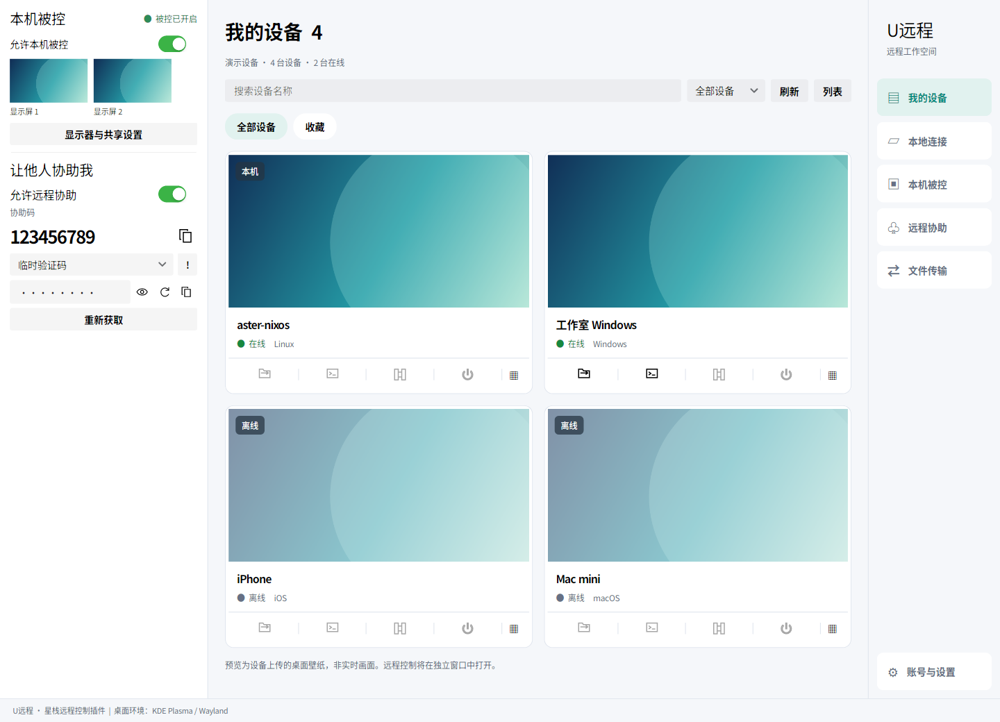

# U远程原生轻应用

## 界面预览



实际界面的宽屏验证截图，使用示例设备、壁纸、协助码和连接信息。状态与“本机被控”标题同行，FPS 位于对应屏幕下方，当前连接显示控制端、连接时长和断开按钮。

状态按实际输入活动判断：连接后显示“正在屏幕共享”，首次有效键鼠操作后显示“正在被控”，断开恢复“被控已开启”；不代表官方主控的模式开关状态。


请先安装并启动 [星栈（AsterDock）](https://github.com/hdward-dev/asterdock)，再从轻应用列表打开 U远程。本仓库提供插件，不提供独立桌面启动器。


U远程作为 Avalonia `IApplicationModule` 运行在 AsterDock 内，不启动网页或 GTK 窗口。
模块入口为 `URemote.Module.URemoteApplicationModule`，清单 ID 为 `u-remote`。
构建宿主会打包到 `Apps/URemote`；`scripts/package-apps.ps1` 会生成独立 appbundle。

## 当前能力

- KDE Plasma / Wayland 的普通防窥屏：本机双屏显示已配置的屏保，远端保持桌面画面和输入；关闭、断开或进程退出后恢复。支持读取预设／自定义屏保并更新图片，要求 Portal 采集及 KWin 的窗口采集排除接口。物理关屏模式尚未支持，详见 [防窥屏与屏保同步](uremote-privacy-screen.md)。

- 右边栏新增“本地连接”：可切换 RDP / VNC，通过 IP 或主机名直接连接，无需 UU 登录。默认端口分别为 3389 / 5900，支持自定义端口、IPv6、RDP 用户名与域。密码不保存，连接后清空输入框。
  RDP 表单按“域、用户名”排序；本机保存最近 5 条成功连接，重复连接置顶，重启后保留。点击“快速连接”复用协议、地址、端口、域和用户名，仅需输入本次密码；已在连接中的会话直接激活，密码不写入历史文件。
  画面在 U远程自己的 Avalonia 窗口中显示，支持等比缩放、全屏、键盘、鼠标、滚轮；Ctrl+Alt+Esc 释放键鼠，关闭窗口断开连接。同一协议、地址、端口和账号重复连接会激活已有窗口，已结束的会话可重新建立连接。
  VNC 支持 RFB 3.3 / 3.7 / 3.8、无认证及传统 VNC 密码认证、Raw / CopyRect / 桌面尺寸变化；暂不支持 VeNCrypt、Tight 认证、音频和剪贴板。传统 VNC 连接本身不加密，应在可信网络中使用。
  RDP 使用 FreeRDP 3 / WinPR 3 动态库及本仓库的 ABI 桥接组件，支持 NLA / TLS、软件解码和键鼠输入。未受信任或变化的证书会在应用中提示，仅明确确认后本次信任，不自动忽略证书。当前发行流程附带 Linux x64 / arm64 桥接组件，仍需系统安装 FreeRDP 3 运行库；其他平台需自行构建对应桥接组件。暂不提供 RDP 音频、剪贴板、文件重定向或动态分辨率。

- 模块版本 0.6.1。主界面、设备卡片、设备详情、本地连接历史、屏幕快照、远程协助、文件传输、账号与设置，以及远程桌面、本地桌面、远程工具和证书窗口都写在 `.axaml` 中。代码负责事件和编译绑定的数据。远控画面仍是窗口里的 `Image`。
- 界面包含“我的设备”“本地连接”“本机被控”“远程协助”“文件传输”“账号与设置”，使用 `AsterDock.UI` 的 `App*` 画笔和 `ad-*` 样式，跟随星栈亮色/暗色主题和宿主强调色；停止被控始终可见。
- 设备列表直接使用当前 UU 登录身份读取，支持名称/编号/平台搜索、在线/设备类型筛选、本机标记、本地收藏、详情及复制编号。
  设备页每 60 秒刷新，失败时保留上次结果；仅收藏编号存放于本机，不保存完整设备列表。在线且允许被控的其他电脑可点击“远程控制”，打开原生独立窗口；重复点击激活已有窗口。

- 默认打开模块后启用被控；停止不会自动重新启用。可选择屏幕、键鼠、系统声音、文本剪贴板和开放时长。
- 退出 AsterDock 时取消会话并清理虚拟键鼠、编码器、音频进程与剪贴板所有者。
  宿主关闭按钮可能隐藏到托盘；需点击停止被控或从托盘退出才能终止。
- 首次登录可在模块内输入手机号和短信验证码。只有点击发送按钮才发送短信，不自动重发。
  保存的登录令牌存放在私有身份文件（Linux 600 权限），只保存用于显示的脱敏手机号，不记录完整手机号和验证码。
- “账号与设置”提供“退出登录”：先停止本机被控并关闭本应用的主控、终端和文件连接，再清除本机令牌和账号状态。当前平台的设备注册保留；旧平台身份退出后，下一次登录按当前平台重新初始化设备，并保留稳定的本机硬件标识。退出操作不自动发送短信。账号页以账号卡片显示登录状态和脱敏手机号；旧身份记录没有手机号时显示 UU 账号 ID。未登录时显示独立登录表单，高级设置默认折叠。
- Linux 按会话选择后端：存在 `WAYLAND_DISPLAY` 或 `XDG_SESSION_TYPE=wayland` 时仍走 Wayland（niri 使用 wlr-screencopy 和虚拟键鼠；KDE Plasma 使用桌面 Portal / PipeWire 采集与 Portal 键鼠控制，锁屏刷新和 uinput 不变）。没有 Wayland 且设置了 `DISPLAY` 时使用 X11（RandR 显示器、MIT-SHM 采集、XDamage 变化检测、XTest 键鼠、CLIPBOARD 文本）。XFCE / xfwm4 这类没有 Portal 和 PipeWire 的会话走 X11。主页底栏显示当前桌面环境及 Wayland / X11 会话类型。
- 壁纸预览按已经识别的桌面环境只查一个来源：KDE 仍读取 Plasma 图片配置、主题默认壁纸和壁纸包的明暗版本（包括 SVG）；XFCE 读取 xfce4-desktop；GNOME、Cinnamon、MATE 和 Unity 读取 gsettings；niri 仍用 DankMaterialShell。没有配置壁纸时卡片保持占位图，不截取桌面。桌面环境变量为空且会话是 X11 时，同一用户的 xfwm4、xfdesktop 或 xfce4-session 会把底栏识别成 XFCE。本机卡片直接生成预览，开启被控后沿用壁纸上传流程。验证码按钮显示 60 秒重发倒计时并在到期后恢复可用。
  Portal 后端在开启被控时由系统弹窗授权共享的显示器和键鼠权限，不保存授权令牌；取消授权不会上线，停止被控会关闭共享会话。最多选择 5 个显示器；重新开启时需重新授权，显示器列表以系统选择器授权结果为准。
  各后端共用持续 FFmpeg/libx264 编码，原始分辨率。Wayland 与 X11 的每屏目标都是 min(显示器刷新率, 控制端请求)：画面变化时按目标发送，且不超过目标。Wayland 静止画面不超过 5 FPS；X11 静止画面可以更低。
  采用 CPU/SHM 管线，非 GPU 零拷贝；没有实现动态码率和即时关键帧反馈，丢包恢复依赖每秒关键帧。
- 系统音频通过 PipeWire `pw-cat` 的输出监视器获取，48 kHz 双声道 / 20 ms Opus 帧，经 SRTP 发送。不采集麦克风。
- Wayland 文本剪贴板使用 `wl-copy` / `wl-paste`，X11 使用 CLIPBOARD 选区（UTF8_STRING）。两者都支持 V3 文本通知及 V4 格式读取响应；V3 文本使用 UTF-8，V4 Windows Unicode 格式使用以空字符结尾的 UTF-16LE。
  当前上限 64 KiB，已加入 Windows Unicode 格式协商及 V4 分块接收；不支持文件/图片。Windows/iOS 官方客户端兼容性需实测。
- 远程终端已接入官方 4.41.0 握手、环境检查、会话列表、新建/恢复、输入输出、窗口调整和关闭。
  使用当前用户的原生 Linux PTY；与键鼠共用本机允许开关。远端断开保留会话，本机停止被控或退出宿主清理会话。
  最多 8 个终端，每个仅在内存保留最多 64 KiB 输出供重连恢复；暂不支持终端重命名，同时只允许一个主控连接。
  本机加密完整回环、Ctrl+C、恢复 Shell 状态测试通过；官方客户端已由用户确认成功创建会话，`uname -a` 正确返回；Ctrl+C 和恢复会话仍待官方客户端实测。
- 被控后端支持 Windows、Linux（Wayland 与 X11）和 macOS。Windows 使用 DXGI Desktop Duplication 采集、SendInput 键鼠、系统剪贴板和当前用户的 cmd 终端；本机预览用 GDI 截屏，避免 DXGI 首帧全黑。远程视频仍是 8 位 BGRA 经 H.264 发出，不携带 HDR。需要本机 PATH 或 `%LOCALAPPDATA%\AsterDock\tools\ffmpeg` 中的 ffmpeg。Windows 触控注入和系统声音尚未接入。

## 验证状态

本地连接新增 121 项检查：VNC 三个协议版本及两种认证的 TCP 回环、分片读取、Raw / CopyRect / 尺寸变化、键鼠与滚轮、取消及越界拒绝；RDP 原生库初始化、实际服务端画面解码、证书回调、拒绝证书、取消与释放。界面另验证 RDP / VNC 切换、默认端口及表单保留。RDP 与 Windows NLA 服务端的实际互通、不同 VNC 服务端兼容性仍需目标机器验证。

KDE Plasma / Wayland 本机后端检查：系统 Portal 授权后，跨越 10 秒连续采集 12 帧 1366×768 BGRA 画面、20 次重复取消采集仍保持共享、零滚动事件、Shift 按下/释放及关闭会话均通过；这不代表官方客户端端到端连接或多屏效果已实测。桌面环境识别覆盖 KDE、niri、GNOME、复合桌面名、未知桌面及 X11。

已确认的此前实测：Windows/iOS 官方客户端连接，Windows 键鼠控制及双屏对应正确。
新增本机验证：110 项协议检查、8 项 WebRTC 回环检查（含 Opus）、连续 H264 编码及解码、剪贴板协议样例、真实 AsterDock 宿主渲染。
本机双屏纯采集约 43 / 37 FPS；该数值不等于远端实际帧率。实时发送日志曾测得一屏约 30–35 FPS、另一屏约 24–26 FPS；不是客户端渲染 FPS。用户已确认画面清晰度、内存单位和退出后再次连接正常。画质切换与剪贴板修复后等待复测，声音尚未验证。

## 设备信息和连接生命周期

本机名称统一为 `aster-{系统主机名}`；每次上线同步 UU 设备显示别名，保留原设备身份。

CPU 来自 /proc/cpuinfo，内存从 MemTotal 转为纯数字 MB（UU 界面自动追加单位），网卡 MAC 来自活动物理接口。
系统版本按用户要求使用 /proc/sys/kernel/osrelease 的内核版本，不替换为发行版。
每次上线使用原有 client_id / system_id 更新设备资料，响应必须保持同一 device_id。
主控端退出仅结束当前媒体会话，本机继续等待连接；信令断开会退避重建房间。仅本机停止或退出宿主（或显式定时到期）停止被控。

## 本机依赖与配置

本地 RDP 连接需要 FreeRDP 3 / WinPR 3 运行库（Ubuntu 24.04 可安装 `libfreerdp3-3 libwinpr3-3`）。开发构建先安装 CMake、pkg-config 和 FreeRDP 3 开发包，再运行 `bash scripts/build-uremote-rdp.sh`，然后构建 URemote.Module；桥接组件会自动复制到模块输出的 `native/<rid>` 中。macOS 可通过安装 FreeRDP 3 后使用同一脚本构建。VNC 不需要外部客户端或原生库。

.NET 10、Wayland 桌面、带 libx264 的 FFmpeg；niri 原生后端需要 screencopy/虚拟键鼠协议。
KDE / GNOME 的 Portal 后端由 C# 直接通过稳定 C ABI 调用 GLib/GIO（D-Bus）和 GStreamer（PipeWire 视频流），不再启动 Python 子进程，也不需要 Python、PyGObject 或 GI 类型库。仍需 `xdg-desktop-portal`、对应桌面实现（KDE 为 `xdg-desktop-portal-kde`，GNOME 为 `xdg-desktop-portal-gnome`）、GLib/GIO、GStreamer core / gst-app / gst-video，以及 PipeWire、videoconvert、appsink 插件。系统共享授权不被绕过；每个显示器有独立的原生采集管线，静止画面复用最近一帧，取消单次采集不会关闭整个会话。Unix 文件描述符、GVariant、视频样本、按住的键和会话在退出或撤销授权时释放；像素与输入正文不写磁盘和日志。
音频需要 PipeWire 和 `pw-cat`；剪贴板沿用 `wl-clipboard`，其支持取决于桌面的 data-control 协议，GNOME 的剪贴板兼容尚未适配。
默认身份位于模块数据目录 `identity.json`，编码器从 PATH 查找；高级设置可修改。
开发时可使用 `UREMOTE_IDENTITY`、`UREMOTE_FFMPEG`。`UREMOTE_NO_AUTO_START=1` 仅用于不联网的界面检查。
请勿把实际身份文件、验证码、原始录屏、音频或剪贴板数据加入源码或 appbundle。

## 真彩与 HDR

Linux 被控端在 NVIDIA NVENC 的 H.264 4:4:4 编码探测通过后，上报真彩能力。主控开启真彩时切换为 High 4:4:4 Predictive、8 位 SDR，关闭后恢复 4:2:0；缩放和显示器切换保留当前色度设置，并分别遵守主控的解码尺寸上限。编码失败时恢复兼容的 4:2:0，不重建桌面共享授权。其他编码后端暂不上报真彩支持。

Linux NVENC 使用 FFmpeg tee/framecrc 输出的包长读取完整编码帧，无需等待下一帧的 AUD 才开始发送。编码窗口按目标帧率和色度限制为 2–4 帧，以重叠拷贝和硬件编码；发送受阻时下一次从采集邮箱读取最新画面。Linux 会尝试扩大编码器自身的输入/输出管道，减少 4K 像素拷贝的进程唤醒，不修改系统管道上限；系统拒绝时沿用现有容量。

发送使用跨帧平均码率预算和有限峰值节流，静止画面积累的额度最多为 500 ms。与本机网卡同子网的直连大帧可平滑突发，路由/中继路径使用较低峰值，明显丢包时临时恢复严格平均速率；不会把每一张大帧都按平均码率拉长。`video-pipeline-delay` 记录编码等待和发送时间，不含屏幕内容。`--video-latency-checks /path/to/ffmpeg` 使用合成 4K 图和发送停顿检查帧积压，附加 `--throughput` 测量编码吞吐量；这些数值不等同于真实桌面端到端帧率或延迟。

真彩是 4:4:4 色度采样，与显示器的 HDR 开关独立。当前采集链路是 8 位 BGRA，尚不支持 10 位 HDR、PQ/HLG 与 HDR 元数据传递，因此不会向主控声明 HDR 支持。2026-11-04，在本机 KDE/Wayland、主屏 3840×2160 60Hz（显示器 HDR 开启）的环境下，经用户使用 iOS 官方客户端实测确认：普通模式和真彩模式均流畅、接近 60 FPS。此为本次设备组合的体验验证，不代表所有设备与网络下的帧率保证。

`--video-timing-checks` 包含真彩请求、状态同步、每种色度的解码上限和回退检查。带可用 NVIDIA 驱动的环境可运行 `--video-true-color-checks /path/to/ffmpeg`，附加 `--video-nvenc4k-checks` 或 `--resize` 检查 4K/缩放输出；测试只使用合成图，核对码流中的真实色度和全部解码帧数。

## 构建与检查

```sh
dotnet build src/URemote.Module -m:1
dotnet run --project tests/URemote.ProtocolChecks
dotnet run --project tests/URemote.Checks -- /path/to/ffmpeg
dotnet run --project tests/URemote.Media.Tests -- /path/to/ffmpeg
dotnet run --project tests/URemote.AccountChecks
dotnet run --project tests/URemote.Checks -- --desktop-environment
# 会弹出系统授权框：采集每屏 12 帧（间隔 1 秒）、零滚动及 Shift 按下/释放，不联网、不保存画面
dotnet run --project tests/URemote.Checks -- --desktop-portal-check
```

`--capture-benchmark` 额外测量真实显示器采集，像素用后清空，不保存或发送。
`URemote.DesktopCheck` 用真实 AsterDock 窗口验证模块渲染；需提供测试 Apps 目录及桌面运行环境。

协议移植参考 MIT 的 iola1999/uurc-web；许可证见模块 `licenses`。SIPSorcery 包含额外使用限制，不能把所有依赖统称 MIT。
音频采集参数参考 https://docs.pipewire.org/page_man_pw-cat_1.html 和 https://docs.pipewire.org/group__pw__keys.html 。
编码参数参考 https://www.ffmpeg.org/ffmpeg-all.html 。

## 尚未完成

主控声音/剪贴板、主控画质设置、设备管理全功能、文件传输、中文 IME、高分辨率/高帧率自适应、完善重连、多观看者、长期稳定性和其他桌面平台被控后端。

## 界面参考

信息结构参考 AnyDesk 通讯录（搜索、收藏与设备详情）和 TeamViewer 设备管理（设备分类），采用 AsterDock 原生控件与主题，不复用其图形资产。
- https://support.anydesk.com/address-book
- https://www.teamviewer.com/en/global/support/knowledge-base/teamviewer-remote/devices/device-groups-explained/


## 原生主控窗口（0.4.0）

- C# / Avalonia 独立窗口，通过现有 UU 账号直接加入设备房间，WebRTC 接收 H264，FFmpeg 在内存中解码绘制。
- 支持鼠标移动、左右中键、滚轮、常用键盘按键、全屏和断开；失焦释放按键，Ctrl+Alt+Esc 将焦点移出远控画面。
- 设备未在线或不允许被控时禁用连接按钮；不强制挤掉其他主控。
- 关闭窗口仅断开其对应设备，本机被控继续运行。不同设备可打开各自的窗口。
- Windows 与 Mac 官方被控端均已实际连接并解码 30 帧 1920×1080；独立原生窗口实际绘制已验证。降低解码缓冲后，一次 Windows 实测首帧约 0.7 秒，非延迟保证。
- 本地回环测试验证键盘封包传输与合成画面的解码尺寸、颜色；实际官方设备键鼠效果待用户交互验证。
- 当前主控不接收声音，不同步剪贴板；显示屏选择提供入口，官方多屏切换待验证。

## 主页集成与远程协助

容器启动时默认显示内置主页，同时在后台初始化已安装的 U远程。主页代码和 XAML 编译在 AsterDock.Host 中，不再作为独立轻应用分发。

本机被控页面包含服务端分配的协助码、本机生成的 8 位临时验证码、显示/隐藏、复制和换码，以及独立的“允许远程协助”开关。开关状态保存到模块设置，关闭会撤销协助会话权限并更新验证码；同账号被控开关保持独立。临时验证码仅存在当前进程内存，重启后更换。协助请求的挑战响应已接入，官方客户端完整协助连接仍需联调验证。

主控端桌面键鼠消息使用 CONTROL_DATA_CHANNEL 的原始 JSON 文本及 WebRTC String PPID，已通过本机加密回环检查；真实远端控制修复后的效果待用户确认。


### niri 桌面快捷键与 uinput

原生 Wayland 键盘路径可以向应用发送按键，但在本机 niri 26.04 上，Super+R / Super+Space 未触发桌面快捷键。现在原生后端优先使用有写权限的 `/dev/uinput`，通过内核虚拟键盘发送按下、松开事件；会话关闭释放按键并销毁设备，不读取物理键盘事件。没有权限时仍回退到 Wayland。日志只报告后端名称，不记录键入内容。

KDE 锁屏（`kscreenlocker`）不接收 RemoteDesktop portal / EIS 的键鼠，画面仍可看到。屏幕锁定期间，观看者的键盘和绝对坐标鼠标改走 `/dev/uinput`：指针按各显示器在虚拟桌面上的位置和尺寸换算，支持多屏和负坐标。解锁后回到 portal。锁定以 `org.freedesktop.ScreenSaver` 的 `GetActive` 和 `ActiveChanged` 为准；logind `LockedHint` 只作补充，因为 Plasma 上它可以在锁屏期间仍为 no。被控在已锁定时启动也会先读 `GetActive`（日志 `portal-start-locked=1`）。`/dev/uinput` 不可写时记录 `keyboard-backend=portal;reason=uinput-unavailable` 并继续走 portal。切换日志形如 `keyboard-backend=uinput;reason=locked`。提交的文字（IME）仍走 portal，锁屏密码需要离散按键加回车。已有 Portal 会话时按锁屏状态切换，`UREMOTE_KEYBOARD_BACKEND=uinput` 不会在解锁后仍强制离开 EIS。解锁或屏保结束会就地更换 PipeWire 采集（`portal-capture-refresh;reason=unblank`），不取消预览、不关闭 WebRTC、也不清空控制房间；只有观看者断开或被控停止才清房间。采集卡住（低码率、低亮度），或就地更换失败，仍会整段重建预览。

`UREMOTE_KEYBOARD_BACKEND=auto` 为默认值；`uinput` 强制使用内核后端，无权限时报错；`wayland` 用于诊断回退。uinput 权限允许该账号注入系统输入，应只授予运行星栈的可信账号，不要设置全用户可写权限。NixOS 可在系统配置中加入以下内容（将 `YOUR_USER` 替换为实际用户名），按正常 NixOS 流程应用配置：

```nix
boot.kernelModules = [ "uinput" ];
services.udev.extraRules = ''
  SUBSYSTEM=="misc", KERNEL=="uinput", OWNER="YOUR_USER", MODE="0600"
'';
```

2026-10-01 本机实测：生产 uinput 后端发送 Super+R 后 niri 窗口宽度发生变化；Super+Space 打开 `dms:spotlight` 启动器。测试后恢复了窗口宽度并关闭启动器。此验证不代表所有合成器、布局或主控端快捷键捕获均已覆盖。


### 信令长连接续期

2026-10-01 的本机日志中，发布端在空闲和远控期间均出现约 21 分钟一次的信令断开；进程保持运行并于约 2 秒后重新上线。官方客户端的既有诊断抓取显示，每条连接间隔约 300 秒发送带 ACK 的 `refresh_reconnect_key`（不带参数），成功响应为 `["success", {"reconnect_key": "…"}]`。旧实现只有 Engine.IO 心跳，漏掉了这一续期流程；这是周期性断线的主要疑点，仍需跨过原有断线周期验证。

现在共享信令客户端每 5 分钟续期，发布端上线时也验证一次。续期校验成功状态和非空密钥；失败时关闭失效信令，让现有重连机制重新授权。结束连接会取消续期任务。诊断只记录成功或失败类型，不记录密钥。

同时按官方已捕获的 `released {user_device_id, ice_id}` 结构定位唯一会话；不再错误地要求必有 `client_id`。旧 ICE 通知和不匹配的身份不会关闭当前会话，格式错误的包被拒绝，不再无条件清空所有会话。

验证：Release 构建通过，177 项协议检查通过；本机部署后的首次续期已获服务器接受。长期远控稳定性尚待连续会话验证。


### 手机输入法提交文字

支持控制通道的 `text_input` / `content` JSON 消息及 VINPUT 包装。此前只处理物理按键，手机输入法提交的整段文字会被忽略。现在在允许输入时把已提交的 Unicode 文本送到桌面；输入内容不写入日志。

Niri/原生 Wayland 使用独立的单层 Unicode 虚拟键盘映射，每 240 个 Unicode 标量分段，支持中文和非 BMP 表情；普通按键和快捷键仍沿用原来的 uinput 后端。Portal 在已解锁且合成器提供 `EI_DEVICE_CAP_TEXT` 时走 EIS UTF-8。KDE 经常没有这项能力，而且锁屏会忽略 EIS；这时改用 KWin `org_kde_kwin_fake_input` 版本 6 的 `keyboard_keysym`（XKB Unicode 键符），锁屏键盘过滤仍会把它交给问候界面。没有键符接口时，未锁定会话再尝试虚拟键盘映射。剪贴板加 Ctrl+V 只在以上路径都不可用时使用，并在粘贴后恢复原来的剪贴板。`ConnectToEIS` 之后不能再调用 `NotifyKeyboardKeysym`。拒绝超限、非法 Unicode 和除换行/制表外的控制字符。

2026-10-04 验证：Release 构建通过，188 项协议检查通过。在本机 Niri 的独立 Konsole 接收窗口中，通过生产解析及输入实现注入中文、英文、表情和跨分段长文本，收到的 798 字节与测试文本完全一致。手机端真实会话仍需复测。


### 原生 Portal 验证（2026-10-08）

`tests/URemote.PortalChecks` 使用隔离 D-Bus 服务和 GStreamer 合成视频测试授权响应竞态、拒绝与取消、Unix FD 列表索引、关闭通知、像素格式、跨度边界、缓存隔离及取消后继续采集。测试不请求真实屏幕授权：

```sh
dotnet build tests/URemote.PortalChecks -c Release
UREMOTE_ISOLATED_TEST_BUS=1 dbus-run-session -- dotnet tests/URemote.PortalChecks/bin/Release/net10.0/URemote.PortalChecks.dll
```

运行环境需要上述原生库以及 `videotestsrc`；无需 Python。`--live-probe` 仅探测当前桌面接口，不打开共享窗口。本机 KDE Wayland 已完成系统授权，读取到双屏；用户已通过远端客户端确认画面和输入正常。GNOME 仍待实机验证。NixOS 需在应用启动环境中提供匹配进程架构的原生库搜索路径和 `GST_PLUGIN_SYSTEM_PATH_1_0`，不能混用 32 位插件；路径应来自系统包配置，不硬编码到插件程序集。

验证结果：Release 全量构建零警告、零错误；188 项协议检查及 32 项原生 Portal 检查通过。本机 KDE 实际会话日志显示原生输入事件已应用，视频发送约 60 FPS；用户确认画面和输入正常。
